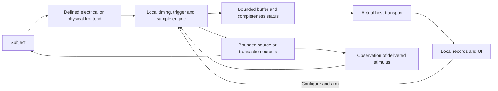

# Acquisition and interface engines

Design proposal, 2026-10-15. This develops the timing, buffering and frontend
boundaries in [ARCHITECTURE.md](ARCHITECTURE.md). It compares complete engine
paths before selecting a processor or FPGA. Rates below are deliberately chosen
comparison workloads, not operator-approved performance requirements or measured
stash capability. They expose design consequences while actual host and lab
equipment identities remain open.

## Proposed division of work

Use the identified BP5 and other intact instruments for supported transactions
first. Preserve the expected SLogic32U3 as an independent digital-observation
candidate. An owned local engine should earn its role through a missing
transaction, trigger, stimulus relationship or supported capture mode.

Propose two classes of owned work:

- **Interface/event engine:** bounded local transactions, conditioned edge
  timing, counters, triggers and modest buffered samples. Compare available
  MCU peripherals/timers/DMA first; PIO is a candidate if suitable RP hardware
  is actually available or justified. Existing BP5 is not spare RP2040 hardware.
- **Acquisition/stimulus engine:** explicitly timed sample movement, local
  buffering, complex triggers and measured stimulus/reference relationships.
  iCE40 is a serious candidate where parallel logic or concurrent timing earns
  its integration cost. Higher-rate analog/RF acquisition retains separate
  frontend, clock, memory and host requirements.

A small supervisory MCU can handle buttons/power coordination without becoming
either engine. One chip could combine roles only after resource allocation and
failure behavior are understood; do not require a separate MCU per diagram box.

## The complete path

These arrows do not imply a common ground, shared clock or arbitrary bidirectional
input. RF, scope, optical and industrial interfaces may require separate paths.
A direct electrical reference may observe a driver rather than the delivered
optical/mechanical stimulus; identify the actual measurement plane.

## Comparison workloads and arithmetic

For packed simultaneous digital samples, payload bytes/second are channel count
times sample rate divided by eight. Analog/IQ figures use the stated stored
sample widths, not ADC effective resolution. MB and kB below are decimal;
KiB denotes 1,024 bytes. Headers, alignment, trigger buffers and host overhead
are additional. Compression is excluded because arbitrary traffic has no
guaranteed compressibility.

| Workload | Chosen representation and interval | Raw rate | Raw record | Design consequence |
| --- | --- | ---: | ---: | --- |
| D1: local bus/event work | A bounded exchange plus edge/event records; exact target timing remains unspecified | Data-dependent | Bounded before arming | Host sends a transaction, never individual time-critical edges; frame/event records do not replace sampled voltage |
| D2: modest digital burst | 8 channels, 10 MSa/s, 10 ms, one packed bit/channel/sample | 10 MB/s | 100,000 B | Plausible buffer-scale comparison for MCU or small FPGA; no continuous USB-Full-Speed claim |
| D3: larger digital burst | 16 channels, 20 MSa/s, 10 ms, packed bits | 40 MB/s | 400,000 B | Exceeds bare RP2040 SRAM and UP5K SPRAM capacity; needs another memory/path or a changed workload |
| A1: correlated analog response | 2 channels, 1 MSa/s each, 16-bit storage, 100 ms | 4 MB/s | 400,000 B | Requires actual ADC/frontends and coherent channel timing; this is not a general scope bandwidth specification |
| A2: faster analog comparison | 2 channels, 25 MSa/s each, 16-bit storage, 20 ms | 100 MB/s | 2,000,000 B | Memory/transport/clock/frontend design dominates; not established on any candidate board |
| R1: complex RF window | 10 MSa/s complex, 16-bit I plus 16-bit Q, 20 ms | 40 MB/s | 800,000 B | Requires a real RF/baseband acquisition path; digital GPIO or packet-radio access does not supply it |

The RP2040's 264 KiB-class total SRAM is shared with software; usable capture
memory is smaller. UP5K has 128 KiB SPRAM and separate 15 KiB EBR with different
port/resource behavior. Neither can retain D3 purely in those on-chip memories.
A 512 KiB external memory has room for D3's payload, but its controller, timing,
allocation and concurrent reads/writes still need qualification.

For D3 at 40 MB/s, an otherwise empty 128 KiB buffer lasts about 3.28 ms.
This is an arithmetic upper bound, not an achievable UP5K mode. A 100,000-byte
D2 upload at an illustrative sustained 1 MB/s takes 100 ms after the 10 ms
acquisition; control/re-arm work adds more dead time. Bounded capture can remain
useful even when the link cannot sustain the acquisition rate, if that dead
time is explicit.

If producer rate exceeds consumer rate, buffer-fill time is usable free bytes
divided by the rate difference. Buffering delays overflow; it cannot make an
unbounded mismatched stream lossless. Exact FIFO packing matters: a 12-channel
engine may place padding in each 32-bit word, so ideal packed arithmetic is a
lower bound on actual memory/transport demand.

## Engine comparison

| Path | Useful role | What must fit | What it does not establish |
| --- | --- | --- | --- |
| Existing BP5 / Flipper / TI / ESP firmware | Supported bus/radio/control functions and bounded observations already implemented on identified hardware | Exact unit/firmware, actual host API, peripheral/pin use, target frontend and loss semantics | Arbitrary spare resources, independent target-side capture, or a reviewed recovery path for replacement firmware |
| MCU hardware peripherals, timers and DMA | Familiar buses, event capture, control/monitoring and bounded waveform sequences | Peripheral mode, DMA/SRAM/bus contention, input timing, local branching and actual board export | Deterministic execution from host messages or an interrupt handler alone |
| RP2040 PIO plus DMA | Compact local pin programs and bounded parallel sampling | Eight state machines across two PIO blocks; shared per-block instruction memory; FIFOs, DMA and shared SRAM; exposed pins and clock plan | FPGA-like unrestricted logic, arbitrary long programs, free BP5 resources, or high-rate continuous traffic over its USB1.1 link |
| iCE40UP5K | Parallel state machines, trigger logic, counters and modest DSP/sample handling | 5,280 logic cells, 128 KiB SPRAM, separate EBR, eight DSPs; package/board pins, clock closure, memory access and external transport | Field-voltage tolerance, analog/RF conversion, deep capture or a USB data engine by merely fitting the chip |
| iCE40HX8K with deliberately designed memory/transport | More logic and I/O options; custom interfaces or wider buffered bursts | Exact package/board; HX and UP resources differ. External RAM/USB wiring must be designed with timing and power | UP5K's DSP/SPRAM features, a complete Glasgow from a bare board, or all maximum rates concurrently |
| A larger FPGA family, such as an appropriate ECP5 part | Growth when proven logic/memory/I/O/concurrency requirements exceed the small paths | Specific device/package/board, clocks, external memory, interface IP, power/heat and host bridge | A solved analog frontend or host bottleneck; family-wide SERDES capabilities on every part |

For our current design, retain MCU/peripheral and small-FPGA candidates in
parallel. Choose the simpler complete path that meets a concrete workload;
prefer a new FPGA when it adds needed concurrency, timing logic or observation.
Do not build a second general logic analyzer merely because an FPGA is available.

## Development boards versus an integrated engine

The current iCEBreaker V1.1b listing includes 64 Mbit QSPI PSRAM and USB-C.
That adds storage capacity, not a verified sustained acquisition path. PSRAM
controller transactions, turnaround and arbitration must meet the workload.
Its older hardware documentation describes optional FTDI asynchronous-FIFO
wiring consuming shared GPIO and requiring board configuration; do not transfer
that implementation or a chip's USB marketing speed to an uninspected V1.1b.

Olimex HX8K-EVB lists 512 KB external SRAM and a separate programming connector;
it needs an actual host data path as well as programming/power. Its 10 ns RAM
description is a component/board fact, not a measured capture bandwidth.

Glasgow revC3 is a useful complete-path reference: iCE40HX8K, FX2 USB controller,
controlled I/O adaptation and local gateware. The project's documented combined
USB throughput is up to 42 MB/s. D3's 40 MB/s payload leaves little room for
other work and is not qualified by that published number. Actual mode/resource/
host behavior decides feasibility. The current general analyzer redesign and
revD-only analyzer2 remain important software boundaries.

An owned design can learn from this division without adopting Glasgow code,
Amaranth, a vendor IP library or a board purchase. The separately expected
SLogic remains an instrument with its own delivered interface, inputs and
performance to verify, rather than a spare programmable FPGA.

## Proposed local engine behavior

### Configure and arm

One local host operation owns the affected interface/resources. Before arming,
it supplies equipment/adapter context, pin directions and electrical role,
sample representation/count, clock and trigger choice, buffer reservation,
output sequence/limits where applicable, and the mode's loss/stop policy.

The engine accepts only a supported configuration with adequate reserved
resources, reports what it actually applied, and rejects unsupported concurrent
use. A changing trigger cannot be supplied one host message at a time. Identify
firmware/gateware version and configuration with the result. Prepared operations
become invalid after reset, disconnect, reconfiguration or unaccounted native
control/target-context change.

Applied configuration is distinct from readiness to arm or acquire valid samples.
The mode identifies who establishes frontend settling, clock/reference readiness
and conversion/filter pipeline validity, using supported status or a qualified
wait/validation appropriate to the selected hardware. Discard old-mode pipeline
contents or preserve an explicitly invalid prefix and first-valid boundary.
An intended observation of the transition retains its timing and changing
configuration instead of labeling the whole record with final steady settings.
Readiness failure/timeout follows the mode's declared output policy.

Capture progress and output/transaction progress are separate when they differ:

| Capture phase | Required output behavior and ownership |
| --- | --- |
| Configure | Acknowledge any intentional power, bias or drive state; otherwise maintain the mode's defined quiescent state |
| Armed/waiting | Hold the declared waiting state; no undeclared trigger-dependent stimulus starts early |
| Trigger/execution | Execute only the configured local transaction or source program |
| Trigger timeout/cancellation | Enter the declared output/transaction result, which may include an intentional held state |
| Acquisition ended / draining | Output may continue only under its declared bounded program or hold policy; capture completion does not mean output stopped |
| Reconfiguration / resource release | Reconcile the previous output/transaction state and reject incompatible changes until its defined transition condition is met |

The owning operation retains pins and output resources while a transaction runs
or an output remains asserted/held, until explicit compatible transfer or release.
Memory reservation is separate: ending a capture does not release physical outputs,
and ending a source does not authorize overwriting the capture.

### Acquire and report

Separate armed/waiting, triggered, acquiring, acquisition-ended, retrieved and
retained-on-host states. A trigger wait can time out without a completed capture.
A finite buffer ending and a host file being durably retained are different
events. Indication must match acknowledged state, including unknown state after
lost confirmation.

Bind capture status, buffer reservations, metadata and drain blocks to the owning
operation and engine reset/configuration generation. A delayed reply or reused
buffer address cannot attach old bytes to a new capture. Keep completed data
reserved until the host acknowledges retention of the required contents or
explicitly requests an identified discard. Planned destructive reset/image
change/reconfiguration drains first or records explicit discard/loss; unexpected
reset can leave data lost or availability unknown, without implying persistence.
New capture and old drain overlap only with distinct adequate resources and
identities. Intentional pre-trigger circular overwrite is a declared acquisition
policy, not permission to overwrite a completed reserved record.

Every result retains the actual sample/record count, clock domain and rate,
trigger position, known gaps/overflow/truncation, reset continuity, frontend
settings and relevant calibration/fixture context. Preserve partial observations
and mark unavailable intervals. Decoded-event modes preserve decoder/configuration
identity and limitations; they are not silently relabeled raw pin capture.
Record clock/reference identity, applied divider or schedule, and whether rate is
nominal, inferred or measured/calibrated. Carry known accuracy, drift and jitter
limits or mark them unknown. Fractional-divider average rate need not imply
identical adjacent sample intervals; qualify variation for the intended mode or
preserve its nonuniform time representation.

Backpressure can delay delivery without being allowed to silently stretch the
measurement's time axis. Each mode distinguishes:

- **Uncontrolled observation:** preserve the sampling schedule with explicit
  losses, end the valid record on a stall, or retain enough independent time/index
  information to describe nonuniform acquisition. Counting only successful FIFO
  writes is not elapsed time. If missing interval location/duration cannot be
  established, mark affected continuity/timing unknown.
- **Throttleable protocol work:** pause only at waits the protocol and subject
  permit, with declared pin states and actual timing retained.
- **Timed stimulus:** detect underrun and locally enforce the declared stop,
  hold or bounded completion policy. Later delivery of all queued values cannot
  establish that the original waveform was delivered on time. Mark affected
  stimulus/reference relationships invalid rather than silently resuming them.

For asynchronous signals, clock tick resolution is not complete timing accuracy.
Specify input synchronization/threshold behavior and frontend latency. Avoid
unsupported causal/phase claims across different instrument clocks. A shared
trigger requires characterized path delay; it does not remove later clock drift.

### Stop, reset and reconfigure

An output-capable mode names the local mechanism that enforces its normal end,
operator stop, host loss, low-energy and reset/restart policy. The policy may
finish a bounded operation, stop, or hold a defined state as appropriate to
the target. Target power and an interrupted firmware operation need their own
completion/recovery semantics; there is no universal power-off rule.

FPGA loading and MCU reset are physical transitions. An external output-enable/
direction control may be necessary to keep the target interface in its defined
state while engine pins are unconfigured. The actual path must work across
power domains; a software flag or configuration-done pin alone does not prove
the intended output state. Never restore a previous active output merely
because firmware/gateware loaded. Reconcile actual configuration and operation
outcome after interruption before dependent actions.

### Independence and contention

Observe the target side of adaptation when waveform correctness matters.
An internal controller's data or output latch does not prove what reached the
target. Loading by observation probes also belongs to the electrical design.

Allocate pins, I/O banks/voltages, memory ports, sample buffers, clocks/PLLs,
DMA channels, host endpoints/throughput and output controls for every concurrent
mode. Budget intermediate FIFO headroom against maximum memory-service
interruption as well as average bandwidth. Include storage/UI/backhaul work in
host tests. A mode that fits alone
may conflict with another mode despite spare logic cells.

## What would justify choosing a path

| Design question | Direct later qualification |
| --- | --- |
| Does local timing meet the actual interface? | Compare emitted/received target-side edges against independent known stimuli over the stated clock/load range |
| Is D2 or another chosen burst retained correctly? | Known input patterns across trigger/buffer boundaries; verify sample order/count, omissions and actual settings |
| Can it stream or drain at the needed rate? | Sustained actual controller/host/storage path plus worst local service interruption, with concurrent intended workloads and explicit gap/backpressure reporting |
| Do output policies survive faults? | Configure/arm/timeout/drain, host/link loss, underrun, engine reset and power transition in a reviewed low-energy fixture; observe actual outputs and outcome state |
| Do retained records survive reuse correctly? | Delayed drain replies, re-arm and reset/image changes; check record identity, explicit release/discard/loss and readiness boundaries against known input |
| Are two observations synchronized enough? | Shared known reference/event, measured relative delay/drift and repeated captures, rather than host arrival timestamps |
| Does it integrate physically? | Populated volume/power/return map with connectors, memory/bridge/frontends, heat and probe access |

These are design qualification questions, not a request to run tests or build
firmware in the present phase. Detailed implementation and fixture plans follow
review and actual equipment identification.

## Recommendation for the next design step

Use D1/D2 as provisional comparison cases for a local interface engine; retain
D3/A1/A2/R1 as explicit pressure on memory, host paths and frontend partitioning.
Ask what existing firmware can already do before an owned implementation.
Compare a small FPGA and MCU path through real pin/memory/transport budgets.

Keep scope/generator and RF requirements open rather than interpreting these
test workloads as the requested instruments' specifications. The next concrete
inputs are actual Pi models, representative lab devices/interfaces, and the
selected capture/stimulus operating points. No board, chip, HDL, library,
toolchain installation, purchase or device operation is selected here.

Source facts and limits come from the
[timing-engine study](../papers/2026-10-15-timing-engine-study.md), existing
[interface survey](../papers/2026-10-15-interface-aftermarket-frumentarii.md) and
[measurement note](../papers/2026-10-15-interface-measurement-methods.md).
