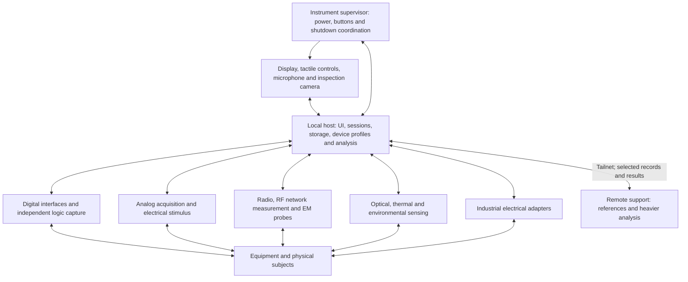

# First r1337 system architecture

Status: proposed design, 2026-10-15. This turns the accumulated research into a
system we can challenge and refine. It is not a bill of materials, a finished
electrical/mechanical specification or authorization to operate equipment.
The operator has selected the service-monitor form and the capability goals;
component assignments below are engineering proposals.

## What the instrument does

r1337 helps an operator identify unfamiliar equipment, observe its physical
and electrical behavior, establish a useful connection, and retain enough
context to return to the work later. It also supports deliberate RF/analog/
optical experiments and management of understood control systems. Breadth is
part of the brief, not a reason to reduce it to one narrow application.

The working object is an equipment session: equipment identity and photographs,
operator notes/audio, interface settings, original measurements, actions and
results, manual references and derived interpretations. Measurements retain
their individual instrument limits and timing. A shared session does not make
separate instruments synchronized or calibrated to each other.

Three representative uses shape the architecture:

1. **Assess an unfamiliar controller.** Photograph its label and connectors,
   dictate observations, retrieve relevant documentation, measure the proposed
   interface, observe traffic, then use an understood adapter and device profile
   to perform a specific operation. Preserve the original traffic and results.
2. **Characterize an RF assembly.** Inspect emissions with a suitable receiver,
   measure cable/antenna/filter response through a calibrated network-analysis
   path, and relate those measurements to physical configuration and notes.
   Different modes can require different connections and operating states.
3. **Investigate an intermittent fault.** Use local triggers and buffering to
   capture electrical or digital behavior, add visible/thermal observations
   where available, and send a selected capture to remote analysis while keeping
   the originals and a usable local instrument.

## Functional boundaries

Arrows describe responsibilities, not a selected bus, shared ground or common
clock. Several blocks may be one physical assembly; none requires its own
external box. The carried system remains one finished core with at most one
optional pocket companion. Probes and target leads need integrated storage.

| Boundary | Proposed responsibility | Consequence |
| --- | --- | --- |
| Local host | Own coherent UI, sessions, storage, profiles, instrument configuration and tailnet access | Start by evaluating an available Pi; exact model and interfaces determine suitability |
| Instrument supervisor | Own physical power button, tactile capture input, indicators, power sequencing and host shutdown coordination | Study a small independent MCU; it does not replace an analog acquisition engine or promise host-independent recording |
| Instrument engines | Own sample clocks, triggers, local buffers, waveform execution and time-sensitive target transactions | USB/network/host scheduling configures work and retrieves results; it does not generate precision sample timing |
| Electrical frontends | Own ranges, coupling, protection, line drivers, termination and grounding/isolation boundaries | A protocol name, connector or GPIO board does not establish compatibility with a target |
| Remote station | Return sourced references, interpretations and computed results for selected local records | Local capture and understood device operation remain usable without it |

The supervisor is a proposed reliability/interaction boundary learned from
[Flipper One](../papers/2026-10-15-flipper-one-frumentarii.md). Its exact scope
depends on available host power controls, recording behavior and hardware. It
must not become an unnecessary second application computer.

One local host operation owns configuration and actions for each affected
physical interface/output while using it. Phone and remote clients submit
requests through that owner. Native instrument controls must participate in
the agreement or invalidate the host's configuration knowledge. Bind prepared
actions and capture metadata to the actual instrument, applied configuration
and equipment/adapter/profile context. Disconnect, reset or an unaccounted
control/connection change invalidates dependent prepared actions until checked
again. Connection context can be operator-confirmed; no automatic target
identification or distributed locking service is implied.

## Capability coverage and stash assignments

[CAPABILITIES.md](CAPABILITIES.md) is the working matrix of coverage, transport,
measurement limits and gaps. The proposed packaging is:

- **An available Pi is the first host candidate.** Evaluate the actual models
  before choosing one. A desktop-class computer is not required by the brief;
  usable sustained I/O, storage, power and cooling decide the comparison.
- **BP5 is the first wired-control candidate**, mounted on a serviceable
  internal carrier if the actual board, firmware and automation interface fit.
  Its own display/probes must remain usable during development. Independent
  logic observation belongs to the expected SLogic32U3 when delivered; no
  optional analog accessory is presumed.
- **A Flipper is the leading candidate for the single pocket role.** Its
  existing independent controls/battery and interface breadth make that worth
  evaluating. Dock access, host API, antenna behavior and standalone usefulness
  must justify inclusion. An empty dock is preferable to adding a redundant
  carried device. Full firmware replacement needs a named capability benefit.
- **The CC1312R1 pair starts as a controlled sub-GHz development pair.** One
  could later earn an internal role; exact fitted RF paths and intended bands
  govern that choice. A programmable packet radio does not fill the general
  raw-I/Q or RF-network-measurement gap.
- **The Nighthawk starts as intact backhaul to evaluate.** Compare its actual
  wired tether/Ethernet behavior and power with wireless backhaul. Integration
  must include its antennas, controls, ventilation and service access; its
  battery is not assigned to power the whole instrument.
- **Pineapple/MK7AC, ESP32 boards, USB test devices and unidentified gear remain
  development resources or conditional instruments.** They earn internal space
  through a missing function and a usable host path. Installing every board
  would spend power, antenna space and service access without necessarily
  increasing capability.

The scope/generator and VNA deserve real design effort: they add missing
measurement classes. Study a shared analog acquisition/stimulus assembly and a
separate calibrated RF network assembly, keeping interference and timing
requirements explicit. Source/receiver reuse within VNA/SNA may be useful;
sharing a connector or software mode is insufficient to establish it.

## Physical architecture

Propose a stable instrument base carrying the connectors and heavier electronics,
with a **screen that lifts/tilts while the main connected test leads stay fixed**.
A protective front cover could become a probe tray or support. This is a
preferred mechanism to mock up, not a selected linkage or construction method.
Compare it with a simple hinged screen before committing to more elaborate
kirigami-inspired motion.

Keep the working face legible in four groups: screen; tactile capture/adjustment
controls; analog/RF measurement connections; and digital/industrial connections.
PTT-style narration should be reachable while the other hand holds a probe.
The microphone needs distance from fans and handling noise. A visible recording
indicator must reflect actual recording state, including storage/host failure.

Use serviceable internal carriers and short, deliberate external connector
paths. Draft three functional regions: compute/power/communications; sensitive
analog/RF paths; and field-interface electronics. These are placement and
coupling hypotheses to measure, not claims that partitions alone provide
shielding or isolation. Metal partitions, RF windows and antenna locations must
follow the selected measurement paths and radios.

Provide space for the expected logic analyzer without making the enclosure
depend on an undelivered outline. The phone can supply inspection photography
and a local/remote client role without being the only display or USB host. If a
phone is to be carried as part of r1337, it must fit inside the integrated core
or take the sole optional companion role; it is not a second detachable module.
The thermal dongle remains an unlocated, unidentified inventory item.

First geometry studies must include connector backshells, fully seated plugs,
probe-lead bend space, screen cable paths, tip-over behavior with attached leads,
handle clearance and service-panel access. A rough volume model can proceed
with clearly marked allowances. Final dimensions and connector panels require
real outlines and connector locations. No mass, ingress or drop rating is claimed.

Integrated analog/RF paths need a named measurement/stimulus reference plane.
Internal pigtails, switches, protection and panel connectors are part of that
path. Choose the plane and calibration method with the frontend; servicing,
replacement or rerouting that changes the path must invalidate affected
calibration or require recharacterization. Preserve repeatable mating, strain
relief and calibration-fixture access in connector studies.

## Power, noise and operating modes

Size energy storage after estimating and measuring actual operating modes.
The reported Nighthawk pack contains 19.4 Wh by its label. For illustration,
a 20 W system with 85% usable conversion would yield about 0.82 h from that
energy; this is arithmetic, not a proposed pack interface or runtime prediction.
FPV packs also need identification before power design. Charging, regulated
rails, protection, host shutdown and any backup energy are one design problem.

Draw the complete power/return-path map before selecting interface frontends:
battery, charger, host and hub USB grounds, instrument grounds, target power,
external target supplies, companion dock and chassis/shields across supported
connection combinations. A self-powered target can still create a return path
through a USB instrument. Assign each target-facing interface to a documented
electrical/power domain. Decide grounding, isolation, common-mode limits and
backfeed behavior per interface; do not assume a shared internal hub or metal
partition creates isolation. The selected paths must support the measurement
bandwidth and target electrical environment.

Propose operating modes that make competing functions explicit:

| Mode | Intended behavior | Design question |
| --- | --- | --- |
| General work | UI, notes, selected instruments and support connectivity | What is the steady load and enclosure temperature? |
| Sensitive observation | Disable or reduce identified internal interferers where possible; record actual state | Which radios, converters, fans and display states alter the noise floor? |
| Stimulus/transaction | Execute a configured waveform, radio operation or target transaction locally | Which observations can run concurrently without contamination or resource conflict? |
| Transport/standby | Protect connectors/display and reduce load; retain useful state | What remains powered and what can wake the system? |

Do not advertise simultaneous capability by counting installed instruments.
Each combination needs adequate power, bandwidth, clock/trigger paths and
measured self-interference. A disconnected radio does not establish a quiet
instrument; switching supplies and digital activity still matter.

Each output-capable engine/profile must define behavior for start/completion,
cancellation, host-link loss, host/engine restart, standby, requested shutdown,
low energy and power restoration. Select an appropriate bounded completion,
stop or defined held/disconnected state for that operation; target power and
firmware writes may need different treatment from a waveform generator. Name
the engine or independent control path that can enact this without the host
and what remains unknown when it cannot confirm completion. The supervisor
has no implied ability to stop an unconnected engine. Operator stop and
power-off are different requests; neither can undo an action already dispatched.
Do not assume unpowered means electrically disconnected. Show actual output/
target-power state when it can outlive the host UI, and do not restore an old
output on reboot without the mode's defined restart behavior. Unsupported
failure behavior excludes unattended use until its design resolves the gap.

A sensitive-observation mode must preserve cooling required by the active
hardware. Reducing fan/radio/compute activity changes the power and thermal
state and can introduce settling time. Record the actual state, visibly report
mode changes and compare noise and temperature together. Qualify sustained
capture-plus-storage and charging-plus-operation as well as short observations.
Quiet operation may require reduced work or deferred uploads; it must not
require overheating the hardware. Plan heat/exhaust paths with ambient sensors
and microphone placement.

## Timing, storage and remote support

Retain instrument-native captures plus the settings needed to interpret them:
channel/range/coupling, sample rate and representation, trigger, probe/adapter,
calibration context, equipment identity, clock domain and operating state.
Keep sample indices and hardware trigger relationships separate from host
timestamps. Cross-instrument timing remains unknown unless a shared reference,
trigger or measured alignment supports it.

Separate capture throughput from control traffic. A raw 32-channel packed
digital stream at 200 MSa/s would contain 800 MB/s before transport overhead;
this illustrative calculation does not establish the SLogic's actual wire
encoding or delivered performance. The host needs the right USB path and
storage, or an explicitly reduced-rate/bounded capture mode. A generic USB hub
cannot be assumed to deliver every attached instrument's maximum concurrently.

Every mode declares whether it produces bounded samples, a continuous stream
or decoded events. Every result distinguishes complete data, a known retained
portion with gaps/truncation, and an unknown or unavailable remainder. Preserve
source indices/sequence information when available, actual settings and
clock/reset continuity; adapters report engine overflow and the host reports
retrieval/storage failure. Define whether a full buffer stops capture, reduces
offered work or records gaps. Bounded acquisition must fit a known local buffer
and report trigger/acquisition/retrieval completion. Never stitch missing
intervals, present a requested duration as completed, or silently overwrite the
only buffered copy. Recording indication follows acknowledged state and shows
failure/unknown when confirmation is lost. A supervisor that cannot observe
storage cannot promise data retention. Exact buffers, durability behavior and
file layout remain later design work.

An equipment session links originals and derived results without replacing
original samples with screenshots, transcriptions or model summaries. Owned
internal values and binary storage follow BLACKBIRD; no internal JSON model,
file format, runtime or third-party library is selected by this design.

Remote support receives selected images, text and capture windows with their
interpretive metadata. Interrupted transfers can resume; local originals remain
available. Returned analysis records the source observations, methods/references
and uncertainty. Analysis may retry; target-changing operations must not be
silently replayed after a reconnect. If a transaction loses its result after
dispatch, record the action and mark its outcome unknown. Do not automatically
repeat it or continue dependent work by assuming success or failure. A profile
can allow documented observations or stop/recovery actions valid under the
remaining uncertainty; those actions have their own results. Where the device
cannot reveal its state, preserve the unknown outcome and require the defined
operator recovery/re-identification step before dependent work resumes.
Tailnet connectivity does not establish application job semantics or a hardware
trigger path.

## Heterogeneous control systems

Keep four distinct parts in each supported connection:

1. The actual connector, pinout and electrical adapter.
2. Bus framing/transport and local timing.
3. Model-specific commands, units, limits and state interpretation.
4. The equipment workflow and its completion/failure conditions.

A device profile records the equipment/firmware it applies to, required adapter,
supported observations/actions and interpretation of responses. A model-number
guess or LLM-suggested command is a research input; it must not silently become
an executable profile. Begin with identified examples from the lab and retain
their documented behavior. Fixed lab gateways may make understood systems
available later without becoming more carried modules.

Firmware access belongs to this same discipline: identify voltage/pinout,
interface, memory map, exact tool behavior and recovery before state-changing
work. Existing Flipper recovery research remains relevant, but does not force
the system's first firmware implementation to be a complete Flipper rewrite.

## What remains to resolve

This is the first system proposal. Detailed electrical design and an
implementation plan require these inputs:

| Next design input | Why it changes the architecture |
| --- | --- |
| Pi model inventory, BP5 revision/firmware/probes, candidate display and actual board outlines | Determines host I/O, practical automation, cooling, carriers and screen geometry |
| A few representative lab interfaces and signal levels | Determines useful analog ranges, line transceivers, grounding/isolation and device-profile scope |
| Scope/AWG bandwidth, channels, ranges and stimulus/load needs | Determines acquisition engine, frontend, clocks, power and verification equipment |
| RF/network-analysis ranges, ports, dynamic range and calibration approach | Determines RF topology, connectors, VNA PCB feasibility and required fixtures |
| Candidate energy stores, actual power states and desired carrying/runtime envelope | Determines pack/rails, charger, heat paths and physical feasibility |
| Delivered SLogic hardware and thermal-dongle identity when available | Resolves conditional interfaces without blocking present system design |

An early bench assembly can answer data-path, noise and operation questions
before enclosure construction, while remaining a development fixture. Its loose
boards would not satisfy the finished product's physical brief. After review,
develop the measurement requirements, block schematics and motion/volume
studies; then review a concrete prototype plan. No software loadout is selected
here. TMTSOYP remains a required future core app, with its purpose/source to be
revisited in that discussion.

## Review and next design work

Three independent reviews challenged
[software/action boundaries](../papers/2026-10-15-architecture-software-review.md),
[measurement feasibility](../papers/2026-10-15-architecture-measurement-review.md)
and [physical/power integration](../papers/2026-10-15-architecture-physical-review.md).
The revision carries their findings into configuration ownership, output fault
behavior, capture completeness, unknown action outcomes, electrical domains,
thermal/noise modes, calibration planes and separate spectrum requirements.
The reports preserve the initial findings and revision assessments.

Continue detailed design in this order, with independent branches where inputs
allow it:

1. Identify the practical host/display and representative lab interfaces; turn
   scope/AWG and RF/VNA goals into useful measurement operating points. Record
   channels, ranges, durations, stimulus/load needs and verification references.
2. Draw electrical/data/clock/power-return blocks for those operating points.
   Map actual host controllers/storage, frontend domains, calibration planes and
   output states. Compare available parts and named gaps before proposing buys.
3. Develop populated motion/volume studies using real outlines where known and
   marked allowances elsewhere. Compare a simple hinge with lift/tilt using
   seated plugs, probe posture, lead forces, cooling and service access.
4. Review the combined design and write a bounded prototype plan whose direct
   checks address the selected ranges, timing, capture failures, output faults,
   unknown transactions and thermal/self-interference behavior.

This is a design-work sequence, not an implementation plan or a claim that the
first proposal supplies finished specifications. Track it in
[issue #7](https://github.com/antimeme-ai/r1337/issues/7). Missing thermal-dongle
identity and future analyzer delivery do not block the first two steps.

## Research basis

This proposal synthesizes acquired/read sources rather than adding hardware
claims. The [research synthesis](../papers/2026-10-15-weird-devices-synthesis.md),
[analog/control report](../papers/2026-10-15-analog-control-frumentarii.md),
[BP5 report](../papers/2026-10-15-bus-pirate5-possibilities.md),
[portable-system report](../papers/2026-10-15-portable-system-possibilities.md),
[iPhone report](../papers/2026-10-15-iphone-integration.md) and
[closed-case sensing report](../papers/2026-10-15-enclosure-sensing.md) preserve
the primary-source links, inspected revisions and limits. Component choices,
packaging and workflows above are proposals, not observations on the stash.

The later [aftermarket and unusual-interface synthesis](../papers/2026-10-15-aftermarket-and-interface-synthesis.md)
adds source-grounded requirements candidates: UHF/contact-card paths, industrial
and sampled-optical frontends, excitation-dependent transducers, intended
optical/supply maintenance channels, physical HMI fixtures and event observation.
It reinforces the existing frontend/timing/fixture boundaries. These are research
inputs to detailed design, not additional selected boards or verified capabilities.
